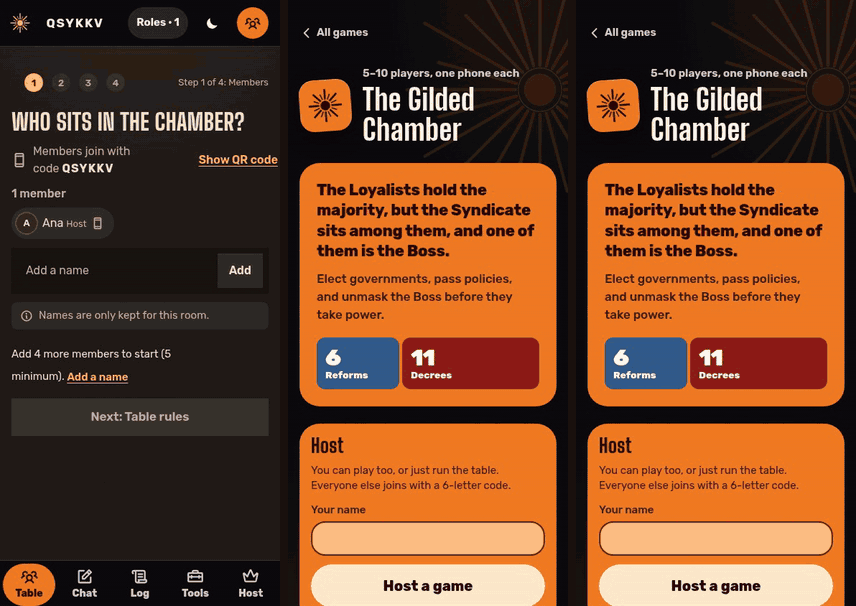

# The Gilded Chamber

A hidden-role voting game for 5 to 10 people in the same room, played on their own phones in the browser.

**Play it: [gilded.hatethespurs.com](https://gilded.hatethespurs.com)**
[](https://gilded.hatethespurs.com)


<p align="center">
  
</p>

## Features

- Loyalists try to pass Reforms and unmask the Boss. The Syndicate try to pass Decrees and get their Boss elected.
- Full rules for 5 to 10 players: elections with term limits, the Unrest tracker, a 17-tile policy deck, executive
  powers that scale with table size, veto, and all four win conditions.
- Secret information stays secret: each phone gets only what its player may see, and roles and cards use
  hold-to-reveal so a glance at a neighbour's screen shows nothing.
- Join with a room code or QR code. A four-step host setup. A dropped phone reconnects to the same seat and role.
- Three play modes: everyone on their own phone, the host's phone only, or a mix where roles, votes and policy tiles
  each stay at the table or move into the app.
- Host tools: pause, undo and redo, skip, replace a player, hand off host, and a script to read aloud. Undo never
  steps back over a secret look.
- House rules and table presets, a public chat with a claims log, a TV table screen, low-light mode and an FAQ.
- Installable PWA that works offline, plus printable cards for groups that want physical play.

## Stack

- JavaScript (ES modules) everywhere. Vanilla JS, HTML and CSS on the client, no framework, no build step.
- Cloudflare Workers, with one SQLite-backed Durable Object per room (WebSocket Hibernation API, 12-hour cleanup alarm).
- Workers Static Assets for the client. Service worker and web app manifest for the PWA.
- Wrangler 4 is the only dev dependency. Tests use `node:test`, browser tests use Playwright with Chromium.

## Run locally

Requires Node 22 or newer. No Cloudflare account is needed.

```sh
npm ci
npm run dev
```

Then open http://localhost:8787. `npm run dev` runs `wrangler dev --local`, which uses the real workerd runtime with a
local Durable Object.

## Tests

```sh
npm test        # 369 unit and integration tests (node:test), about 35 s
```

The suite covers the rules at every table size, every win path, the play modes, host tools, undo and redo, and
secrecy for every view. One test is skipped unless `WAKE_KIT` points at the shared reconnect helper it compares
against. [`RULES.md`](RULES.md) maps each house rule to the test that guards it, and
[`docs/logic-audit.md`](docs/logic-audit.md) records the logic audit.

Browser tests drive a host and four player phones in Chromium against a local `wrangler dev`:

```sh
npm i --no-save playwright-core
CHROME=/path/to/chrome npm run e2e
```

To play whole games with scripted players and check every view for leaked secrets:

```sh
npm run dev -- --port 8862 --ip 127.0.0.1
BASE=http://127.0.0.1:8862 GAMES=60 node scripts/sim-games.mjs
```

## Project structure

```
src/worker.js            Worker routes (/api/create, /api/room/:code, /ws/:code) and the Room Durable Object
public/index.html        App shell
public/js/rules.js       Pure game rules: teams, deck, powers, term limits, win checks
public/js/room.js        Reducer for every action, plus the per-player and table-screen views
public/js/event-log.js   Append-only event log behind undo and redo
public/js/table.js       Shared table layer: chat, log, host tools, play modes
public/js/app.js         Client: renders the view it is sent and sends actions over the WebSocket
public/sw.js             Service worker (versioned cache, offline app shell)
public/print/            Printable card sheets and rules guide (PDF)
scripts/                 Build, deploy, contrast and full-game simulation scripts
test/                    node:test suites; test/e2e/ holds the multi-phone browser tests
wrangler.jsonc           Worker, Durable Object and route config
```

The server is authoritative. Phones send actions, the room's Durable Object runs them through the reducer, and every
phone gets back its own filtered view, so no phone ever receives another player's role or the deck order. The rules
and reducer are plain modules with no I/O, so the same code runs in the Worker and under `node --test`.

## Deploying

`npm run deploy` runs `wrangler deploy` with `CLOUDFLARE_API_TOKEN` and `CLOUDFLARE_ACCOUNT_ID` set. A manual GitHub
Actions workflow is in `docs/github-workflows/deploy.yml`. See [docs/deploying.md](docs/deploying.md) for details.

## Credits

- An original game in the hidden-role policy family. The names, wording and art are its own.
- Fonts: Big Shoulders Display, Alegreya, Alegreya Sans and Rubik (SIL OFL 1.1); Special Elite (Apache 2.0).
- Interface icons: [Phosphor](https://phosphoricons.com) (MIT).
- Sister apps: [Mafia Night](https://mafia.hatethespurs.com) and [Quest Night](https://avalon.hatethespurs.com).

## More screenshots

<p>
  
  
  
</p>
