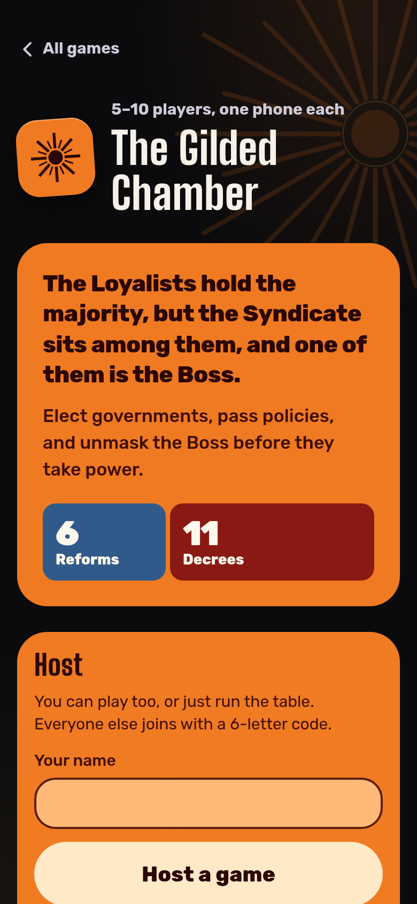
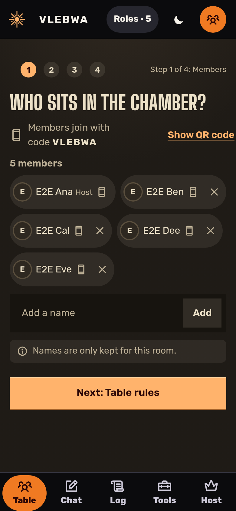
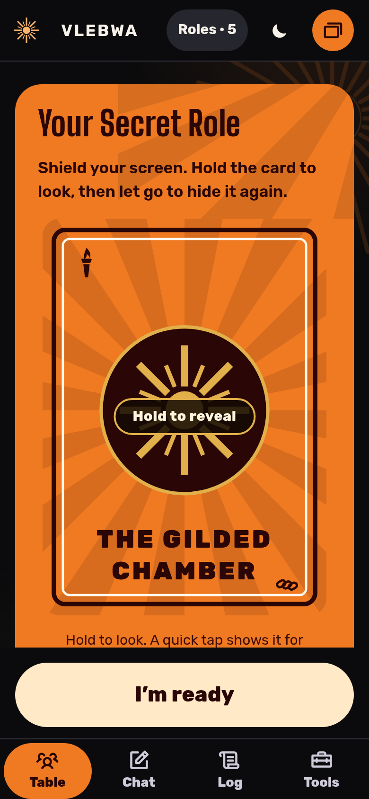

# The Gilded Chamber

The Gilded Chamber is a hidden-role policy game for 5 to 10 people in the same room, each playing on their own phone
(or on the host's phone alone). Loyalists try to pass Reforms and unmask the Boss. The Syndicate try to pass Decrees
and get their Boss elected. Under the hood, one Durable Object per room holds the only copy of the game state. Each
phone receives a per-viewer projection that contains only what that player may see. The client is an installable,
offline-capable PWA with no framework. A 369-test suite plus scripted full-game simulations check the rules and look
for secrets leaking into any view. It is a sister app to [Mafia Night](https://mafia.hatethespurs.com) and
[Quest Night](https://avalon.hatethespurs.com).

**Live:** https://gilded.hatethespurs.com

<p>
  
  
  
</p>

## Features

- Full rules for 5 to 10 players: elections with term limits, the Unrest tracker, the 17-tile policy deck, executive
  powers that scale with table size, veto from five Decrees, and all four win conditions.
- Join with a six-letter room code or a QR code. Host setup takes four short steps (members, table rules, seating,
  deal). A dropped phone reconnects to the same seat and role.
- Three play modes: everyone on their own phone, the host's phone only, or a hybrid where roles, votes and policy tiles
  can each stay "at the table" or move into the app.
- Optional house rules: rebalanced 6/7/9 player games, exile instead of execution, anonymous votes, no-claims mode, a
  phase timer, and more. Table presets save a full set of choices.
- Host dashboard: pause, undo and redo, skip, nudge, replace a player in the same seat, hand off host, and a phase
  script to read aloud. Undo never steps back over a secret look.
- Public table chat with a claims log, a game log, a TV "table screen" with no secrets on it, a desktop layout, a
  low-light mode, and an FAQ.
- Printable card sheets and a rules guide (`public/print/`) for groups that want physical cards.

## Stack

- **Language:** JavaScript (ES modules) everywhere. No build step for the client.
- **Server:** Cloudflare Workers, with one SQLite-backed Durable Object per room. It uses the WebSocket Hibernation API
  and an alarm that deletes the room after 12 hours.
- **Static files:** Workers Static Assets.
- **Client:** vanilla JS, HTML and CSS. No framework and no runtime dependencies.
- **PWA:** web app manifest and a service worker. Static files are cache-first from a versioned cache, and the app
  shell is the offline fallback for navigation.
- **Optional:** a Workers AI binding for an "ask a rule" helper. It answers only from the game's own rules text. It
  stays off (`AI_MODE: "dark"`) until a UI ships.
- **Tooling:** Wrangler 4 (the only dev dependency), `node:test`, and Playwright with Chromium for browser tests.

## How it works

```
src/worker.js          Worker routes (/api/create, /api/room/:code, /ws/:code) and the Room Durable Object
public/js/rules.js     Pure game rules: teams, deck, powers, term limits, win checks
public/js/room.js      Reducer for every action, plus viewForPlayer / viewForScreen (all secrecy lives here)
public/js/event-log.js Append-only event log behind undo and redo
public/js/table.js     Shared table layer: chat, log, host tools, play modes
public/js/app.js       Client: renders the view it is sent and sends actions over the WebSocket
```

- The server is authoritative. Phones send actions, the room runs them through the reducer, and every phone gets back
  its own filtered view. No phone ever receives another player's role or the deck order.
- Room state and the event log are kept in Durable Object storage, so a room survives hibernation and reconnects.
- The rules and the reducer are plain modules with no I/O. The same code runs in the Worker and under `node --test`.

## Run locally

Requires Node 22 or newer (CI uses Node 24). No Cloudflare account or login is needed.

```sh
npm ci
npm run dev
```

Then open http://localhost:8787. `npm run dev` runs `wrangler dev --local`, which uses the real workerd runtime with a
local Durable Object.

## Tests

```sh
npm test        # 369 unit and integration tests (node:test), about 35 s
```

The suite covers the rules at every table size, the powers table, deck reshuffles, veto, term limits, Unrest, every win
path, the play modes, host tools, undo/redo, and secrecy for every view. `RULES.md` lists each house rule with the test
that guards it. [`docs/logic-audit.md`](docs/logic-audit.md) records the logic audit: what was checked, what was
fixed, and the five rule choices.

Browser tests drive a host and four player phones in Chromium against a local `wrangler dev`:

```sh
PW=/path/to/node_modules/playwright-core CHROME=/path/to/chrome npm run e2e
```

Other files in `test/e2e/` run the same way with `node test/e2e/<name>.e2e.mjs`. To play whole games with scripted
players and check every view for leaks, start the dev server and run:

```sh
npm run dev -- --port 8862 --ip 127.0.0.1
BASE=http://127.0.0.1:8862 GAMES=60 node scripts/sim-games.mjs
```

`node scripts/contrast.mjs` checks every color pair in both themes against WCAG AA.

## Deploying

Run `npm run deploy` (`wrangler deploy`) with `CLOUDFLARE_API_TOKEN` and `CLOUDFLARE_ACCOUNT_ID` set. Or use the GitHub
Actions workflow in `docs/github-workflows/deploy.yml`. It runs only when started by hand, runs the tests first, and
then runs a live smoke test. See [docs/deploying.md](docs/deploying.md) for the service worker version, the Durable
Object migration, and the API-based deploy path.

## Credits

- An original game in the hidden-role policy family. The names, wording and art are its own.
- Fonts: Big Shoulders Display, Alegreya, Alegreya Sans and Rubik (SIL OFL 1.1); Special Elite (Apache 2.0).
- Interface icons: [Phosphor](https://phosphoricons.com) (MIT).
